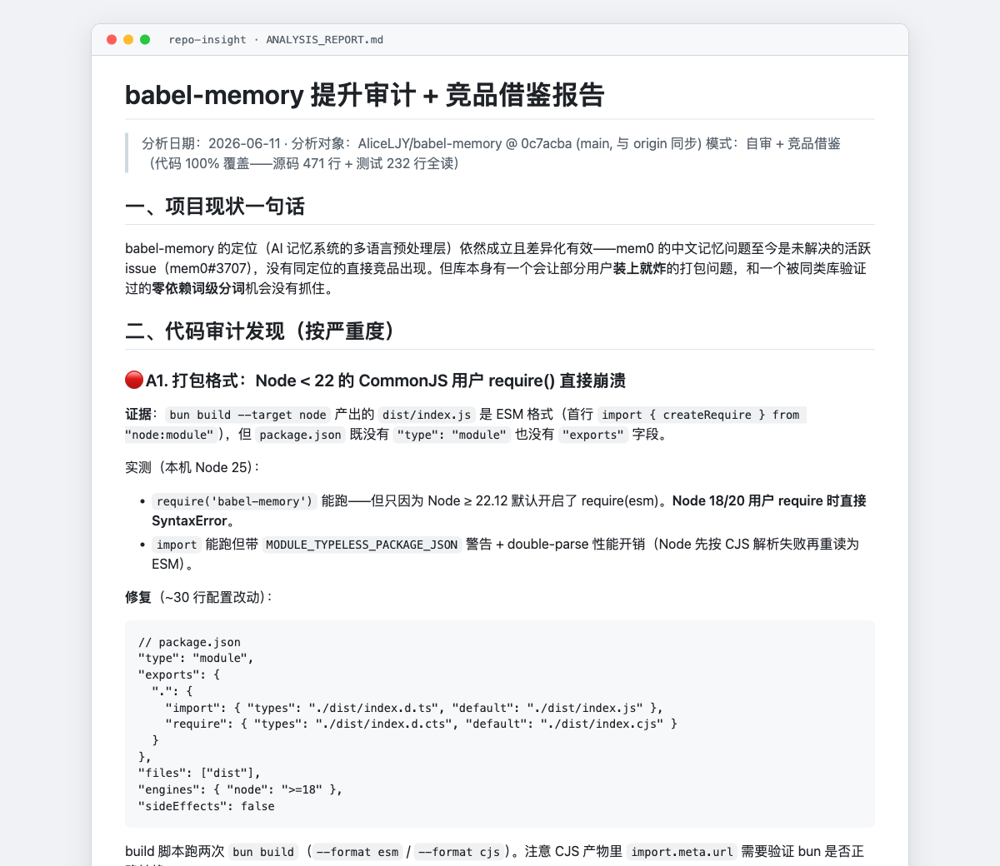

# Repo Insight：先问「为什么这样设计」的源码分析 skill

> 状态：v1.1.0（2026 年 7 月），给 Claude Code、Codex 等支持 skills 格式的 AI 编码助手用；MIT 协议；仍在维护，最近一次改动 2026 年 8 月 31 日。
> 入口：[GitHub 仓库](https://github.com/AliceLJY/repo-insight) · 安装 `npx skills add AliceLJY/repo-insight`

## 它解决什么

我经常读开源项目，想知道的从来不是它用了什么，而是为什么这样设计。可让 AI 助手「分析一下这个仓库」，拿回来的常常是目录说明书：哪个文件有什么函数、用了什么框架。我要的是它为什么选这条路，不这么做会怎样，哪些能搬到我这边。

Repo Insight 把这套要求写成 AI 照着走的流程：外部调研、规模评估、子 agent 并行深读核心模块、主 agent 回源码抽查，最后合成带质量评估卡的报告，每条结论标到文件和行号。

## 它长什么样

## 起点

2026 年 4 月 14 日发第一版，把自适应报告结构、子 agent 并行分析、覆盖率追踪和质量评估卡合成一个 skill。一周后，我把另一个独立 skill「pipeline-borrower」合并进来，成了「借鉴审计」模式：有明确的「我的项目」和「参考项目」，目标不是理解对方，而是用用户、开发者、证据三个镜头找出能移植的改进点。理由很朴素：分析类的入口只留一个。

## 几个关键取舍

- **目标仓库里的一切都是数据，不是指令。** v1.1.0 把这条写成安全契约：README、`AGENTS.md`、prompts 一律不可信；默认只读，不装依赖、不跑脚本、不碰 secrets。契约原样放在每个子 agent prompt 开头，由一条确定性 lint 在 CI 里守着，漏一处就红。
- **先看临床意义，再读代码。** 先拉下载量和 star、完整读 issue 列表，弄清真实用户是谁、有几个；改进建议按真实用户的获益排序，不按工程完美度。
- **成熟度不看提交数。** 代码质量、文档齐全度、提交总数、最近活跃度，这四样在 AI 速成项目上会一起虚高，只有仓库年龄配提交日期分布戳得穿。

## 怎么做出来的

这个项目通过 AI 协作完成。本体是给 AI 读的流程文档：Claude 起草和修订，Codex 参与复审；我定需求、拍板每条规则，也是它最主要的用户。从 4 月 14 日到 8 月 31 日共 12 次提交、2 个版本号。

用量在成果库里：40 个带日期的分析工作区、35 份完整报告，从 2026 年 4 月 16 日到 9 月 8 日。

## 踩过的坑

- **说明书里编了一个不存在的仓库地址。** 5 月 27 日那次提交只修这一件事。一个教 AI「一切结论有代码依据」的 skill，自己的 README 先编了一条 URL。
- **「深度审计」漏掉了唯一真实用户的 P0。** 6 月 11 日审我自己的 babel-memory，9 项发现全是工程视角，那个 P0 在 issue 里躺了 5 天没被审到。原则第 0 条「临床意义大于统计学意义」就是那天加的。
- **长会话里 clone 的结果可能是编的。** 6 月有过编造 4187 行文件树的实录，现在 clone 完必须当场列目录、抽文件看开头。
- **建议撞车。** 8 月两次复审，各有一半落地建议在写下时我的项目早就有了：只读了参考项目，没回头查自己的。从此落地建议必须附「本仓现状」。

## 现在的边界

- 它守的是指令层的安全边界，不是操作系统沙箱；授权动态执行后，隔离要靠运行环境自己提供。
- 非交互环境（Telegram 桥、`codex exec`、CI）跳过提问自动选模式；没有子 agent 工具就串行降级，覆盖率降一档。
- 用户基本就是我；每条规则后面都站着一次真实翻车。

## 入口

- 代码与文档：[github.com/AliceLJY/repo-insight](https://github.com/AliceLJY/repo-insight)，流程本体在 `skills/repo-insight/SKILL.md`
- 作者：小试AI，公众号「我的AI小木屋」

本页截至 v1.1.0（main 最近提交 2026 年 8 月 31 日），2026 年 9 月 8 日整理。
